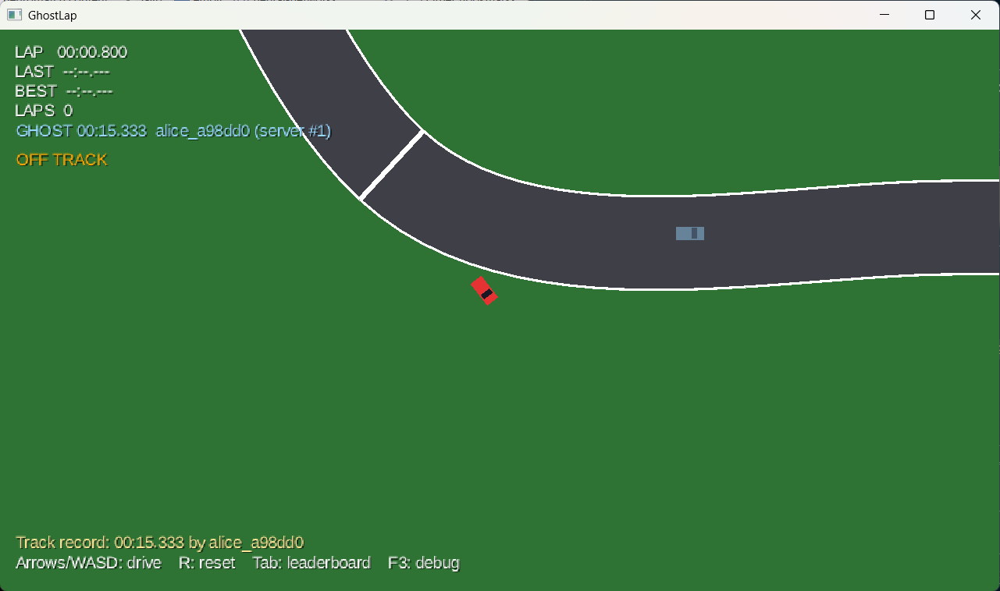
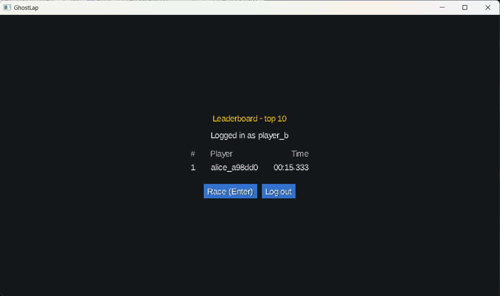
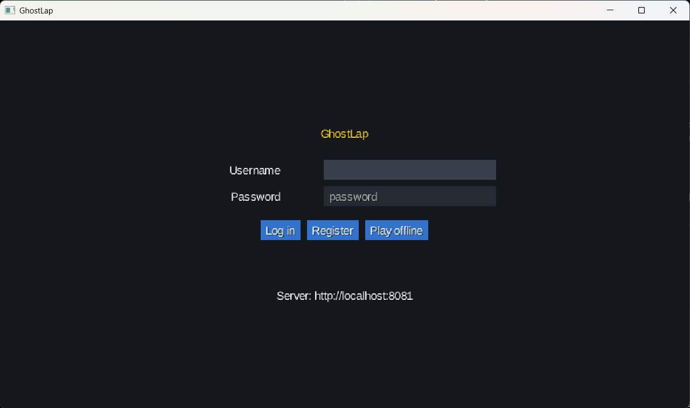
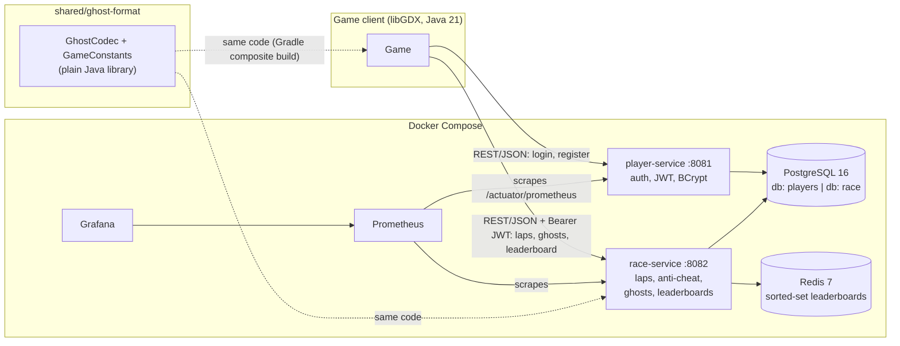

# GhostLap

**A top-down time-trial racer where you race other players' best laps as ghosts, with Spring Boot microservices that catch cheaters by replaying the ghost on the server.**

Java 21 · libGDX · Spring Boot 4 · PostgreSQL · Redis · Docker · Prometheus/Grafana · GitHub Actions · k6

| Racing a downloaded ghost | Leaderboard | Login |
|---|---|---|
|  |  |  |

> 🎬 **GIF placeholder:** `docs/images/demo.gif`, a full lap against a ghost (record with ShareX or ScreenToGif).
> 📊 **Screenshot placeholder:** `docs/images/grafana.png`, the Grafana dashboard during a cheater run.

---

## What it is

You drive a lap. Your car's position is recorded 30 times a second into a compact binary **ghost**.
When the lap is uploaded, the server **decodes the ghost and checks it against the game's physics**
(speed limit, sample count, checkpoint order, minimum lap time) before it can reach the leaderboard.
Every other player can then download the fastest ghost and race against it as a see-through car.

The game and the server use **the same Java library** for the ghost format and physics constants, so
they can never disagree about what a valid lap looks like.

## Features

**Game (libGDX, desktop)**
- Smooth closed-loop track from a Catmull-Rom spline, ordered checkpoints, lap timing in physics ticks.
- Arcade car physics on a **fixed 60 Hz timestep**, with render interpolation and a slight drift (forward/lateral velocity split).
- Ghost recording at 30 Hz. Playback interpolates position and takes the short way round for the heading.
- Login / register / play offline (scene2d.ui), Results/Leaderboard screen, F3 debug overlay.
- **All network calls are asynchronous:** the render thread never waits on HTTP. Failures are handled gracefully: server down, expired token, rejected lap.
- Benchmark mode with frame-time percentiles, allocation tracking and GL draw-call counts.

**Backend (two Spring Boot microservices)**
- `player-service`: register/login with BCrypt, issues HS256 JWTs.
- `race-service`: lap submission with **server-side anti-cheat**, ghosts stored as `bytea`, **Redis sorted-set leaderboards** that can be rebuilt from Postgres.
- Database per service (separate Postgres logins), Flyway migrations, RFC 7807 errors, Swagger UI.

**Production polish**
- Custom Micrometer metrics (`ghostlap_laps_rejected_total{reason}`, validation timer), request IDs in every log line.
- Prometheus + a provisioned Grafana dashboard: request rate, p95 latency, laps, rejections by reason, JVM memory.
- A "cheater" client that attacks the anti-cheat on purpose.
- GitHub Actions CI: builds and tests all four projects (with real Postgres/Redis via Testcontainers), then builds the Docker images.
- k6 load test.

## Architecture



- The services **never call each other.** race-service checks the JWT signature with the shared secret and reads the player id and username from the token.
- **Postgres is the source of truth;** Redis holds each track's leaderboard and is rebuilt from Postgres on startup if it's empty.

## Run it (3 commands)

Prerequisites: **Docker Desktop** (running) and **JDK 21 or newer**.

```powershell
# 1. Config: the template works as-is for local use (change the secrets for anything real)
Copy-Item infra/.env.example infra/.env          # macOS/Linux: cp infra/.env.example infra/.env

# 2. Backend: Postgres, Redis, both services, Prometheus, Grafana (first build takes a few minutes)
docker compose -f infra/docker-compose.yml up --build -d

# 3. Game
cd game; ./gradlew lwjgl3:run                    # Windows: .\gradlew.bat lwjgl3:run
```

Register an account in the game and drive. **Arrows/WASD** drive, **R** resets, **Tab** opens the leaderboard, **F3** shows the debug overlay.

| What | Where |
|---|---|
| Swagger UI | http://localhost:8081/swagger-ui.html and http://localhost:8082/swagger-ui.html |
| Grafana | http://localhost:3000 (dashboard "GhostLap Overview", no login needed to view) |
| Prometheus | http://localhost:9090 |
| API reference | [docs/API.md](docs/API.md) |

**Try the anti-cheat:** `cd game; ./gradlew cheater:run --args="--rounds 20 --delay-ms 500"` sends fake laps
(impossible time, teleporting, skipped checkpoints, ...) and the "rejected by reason" panel in Grafana moves.

**Load test:** `cd infra; docker compose --profile loadtest run --rm k6`

> Postgres is published on host port **5433** (not 5432) to avoid clashing with a locally installed Postgres.

## How the anti-cheat works

The client sends `{trackId, lapTimeMs, checkpointTimesMs[], ghost}`. race-service decodes the ghost
(base64 → gzip → binary `GHST` format) and rejects the lap with a reason code if any rule fails:

| Reason | Rejected when |
|---|---|
| `TOO_FAST` | faster than the track's minimum plausible time |
| `CHECKPOINT_ORDER` | not 8 checkpoint splits, not strictly increasing, or the last ≠ the lap time |
| `BAD_GHOST` | undecodable, or the ghost's header doesn't match the lap |
| `SAMPLE_COUNT_MISMATCH` | samples ≠ lapTimeMs × 30 Hz (±2) |
| `SPEED_EXCEEDED` | moved faster than `MAX_SPEED × 1.1` between two samples |

Rejected laps are stored with the reason (for auditing) and never reach the leaderboard. Every rule has its own unit tests, including the boundary values.

**Ghost format:** 19-byte header (`GHST`, version, trackId, sampleRate, sampleCount, lapTimeMs) plus 12 bytes
per sample (`float x, y, heading`), gzipped. A 15-second lap is **~5.3 KB**, 4.4× smaller than the same data as JSON.

## Performance

All numbers were measured on the development laptop (i5-12450H, Intel UHD integrated graphics, Windows 11,
everything in Docker Desktop on the same machine). Methods and raw runs are in [docs/PERFORMANCE.md](docs/PERFORMANCE.md).

**Game** (benchmark mode: autopilot, vsync off, 20 s measured after a 5 s warm-up, medians of several runs)

| Metric | Before | After |
|---|---|---|
| Garbage on the render thread | 2,808 bytes/frame | **7 bytes/frame** |
| GC collections per 20 s | 1 | **0** |
| Vertices sent to the GPU per frame | 6,714 | **~2,300** (culling) |
| `render()` CPU time, average | 0.429 ms | **0.362 ms** |
| Startup: `create()` → first frame | 603 ms | **207 ms** |
| Startup: JVM start → first frame | 1,633 ms | **1,134 ms** |

**Backend** (k6: 50 virtual players, each registers, then loops submit lap + 3 leaderboard reads)

| (average of 2 back-to-back runs each) | Before | After |
|---|---|---|
| Throughput | 752 req/s | **832 req/s** |
| Latency p95 / p99 (all requests) | 87 / 141 ms | **73 / 122 ms** |
| Submit lap p95 | 128 ms | **111 ms** |
| Errors | 3 x HTTP 500 | **0** |

The load test found **a hidden extra SQL `SELECT` before every lap insert** (Spring Data `merge` on an
entity with an assigned id), fixed with `Persistable`, and **a Redis race condition** (a leaderboard read
between two writes -> HTTP 500), fixed with a `MULTI/EXEC` transaction.

## Tests and CI

| Project | Tests | What they cover |
|---|---|---|
| `shared/ghost-format` | 16 | codec round trips, 10 kinds of corrupt data |
| `game` | 55 | physics, spline track, lap timing, ghost record/playback, HTTP client against a fake server, an autopilot that drives full laps headlessly, plus 1 opt-in live test against the real backend |
| `player-service` | 21 | every endpoint with a real Postgres (Testcontainers), JWT edge cases, request IDs |
| `race-service` | 58 | every validation rule, every endpoint with real Postgres + Redis, leaderboard rebuild, metrics, query counts |

Run any of them with `./gradlew test` in the project folder. [`.github/workflows/ci.yml`](.github/workflows/ci.yml)
runs `./gradlew build` for all four projects in parallel on every push, then builds both Docker images.

## Project structure

```
shared/ghost-format/   ghost binary codec + physics constants (used by game AND race-service)
game/                  libGDX desktop game (core, lwjgl3 launcher, cheater tool)
services/
  player-service/      Spring Boot: accounts + JWT          (port 8081)
  race-service/        Spring Boot: laps, anti-cheat, ghosts, leaderboards (port 8082)
infra/                 docker-compose, Postgres init script, Prometheus config, Grafana dashboard
loadtest/              k6 script
docs/                  API, design decisions, performance, progress
```

## Design decisions (summary)

The full list, one line each with the reason, is in [docs/DECISIONS.md](docs/DECISIONS.md). Highlights:

- **Fixed 60 Hz physics, lap time counted in ticks:** deterministic, so the same inputs always give the same lap, and the server can check it.
- **One shared library for the ghost format and physics constants** (Gradle composite build): the client and the server can't drift apart.
- **Binary ghost format instead of JSON:** 4.4× smaller. gzip only adds ~5% on raw floats, but brings a CRC that catches corruption.
- **Database per service, enforced** with separate Postgres logins. No cross-service foreign keys; the username is copied onto laps.
- **Stateless JWT auth (HS256):** race-service verifies tokens itself, so the services stay independent.
- **Postgres = source of truth, Redis = fast leaderboard,** rebuildable at any time. Postgres is written first, Redis after the commit.
- **A rejected lap is a normal `201` with a reason,** not an HTTP error: the request was fine, the lap wasn't.
- **The client never blocks the render thread:** async HTTP with results handed back via `Gdx.app.postRunnable`, plus timeouts and an offline mode.
- **Measure before optimising:** benchmark mode and A/B runs. A texture atlas was skipped because the game binds only 1 texture per frame, and AppCDS was tried and rejected.

## How I built this with an AI coding agent

I built GhostLap with **Claude Code** (an AI coding agent) as a pair programmer, and I want to be upfront about how.

- **I set the plan first.** Before any code, I wrote a context file ([`CLAUDE.md`](CLAUDE.md)) with the tech stack, the API contract, the ghost binary format, the anti-cheat rules and a 6-phase checklist. Every phase was one prompt with a concrete "done when" (for example, "account B races against account A's ghost downloaded from the server").
- **The agent wrote most of the code and tests;** I directed, reviewed and ran things. It had to prove each phase worked, not just compile it: tests at every layer, a headless autopilot driving real laps, screenshots of the running game, a live end-to-end test against the Docker stack, and A/B benchmark runs.
- **Learning was a hard requirement.** The rules in `CLAUDE.md` say: simple, conventional code, one line in `DECISIONS.md` for every design decision, and a plain-language explanation after every phase. Those explanations became [`docs/INTERVIEW_PREP.md`](docs/INTERVIEW_PREP.md), which I study from.
- **What the agent caught that I wouldn't have:** a Windows-only flaky test (a background process locking files), `gradlew` missing its executable bit in git (CI would have failed on Linux), a Redis race condition that only showed up under load (a leaderboard read between two writes returned HTTP 500), and a hidden extra SQL `SELECT` on every lap insert.
- **What I had to watch:** keeping scope tight (no features outside the current phase), and checking that measurements were honest. For example, an apparent +51% throughput win turned out to be partly machine noise, so we re-measured with back-to-back A/B runs.

---

*Portfolio project for game and backend engineering internships.*
